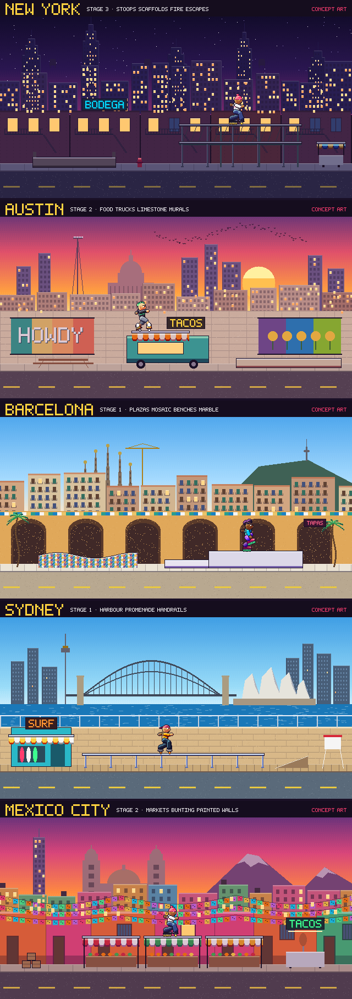
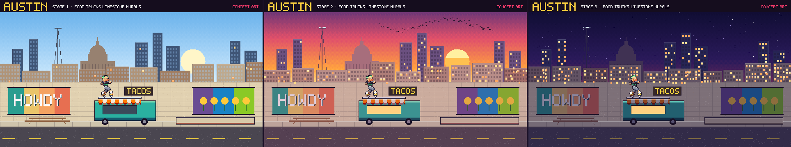
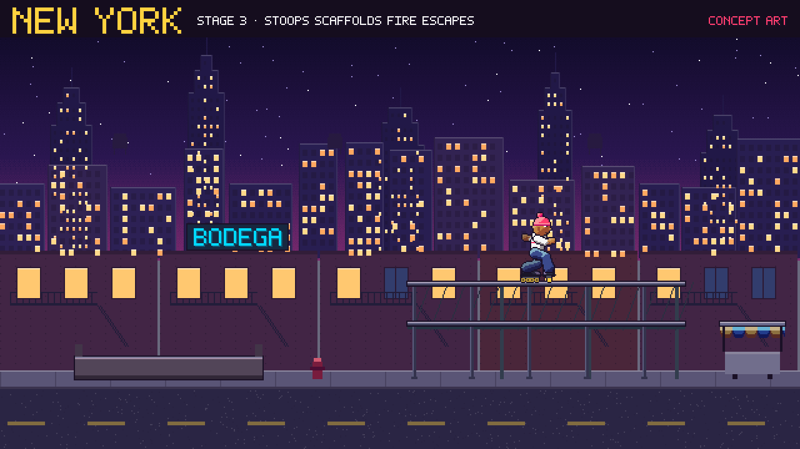
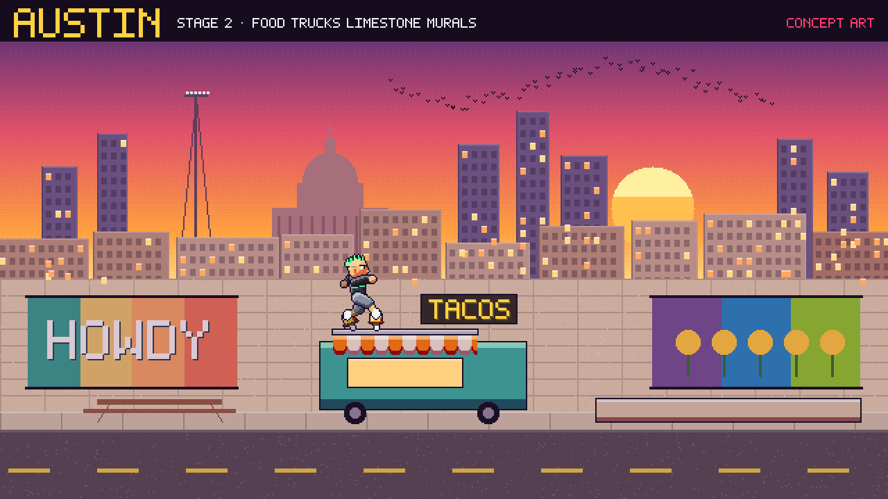
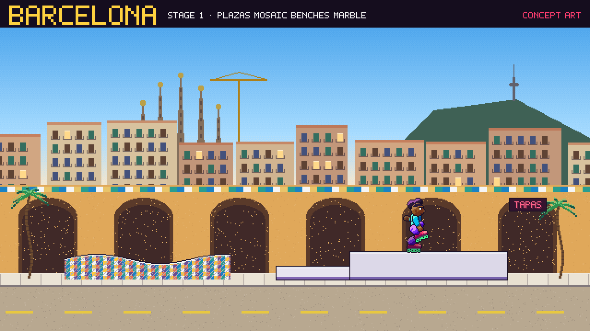
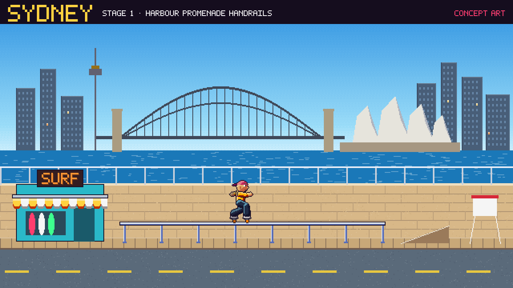
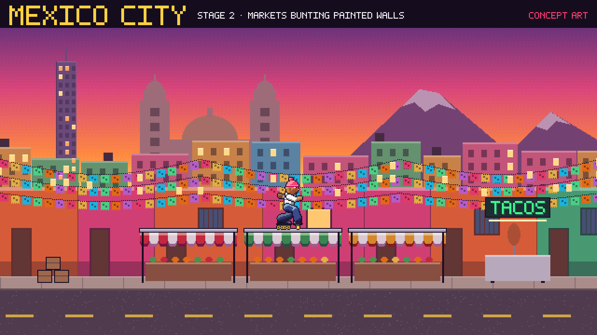

# Cities and stages — draft plan

**Status: a plan and concept art. Nothing here is built.** Drafted 2026-11-24 from the user's brief:
several cities as the main areas, three stages per city that get harder, a city selector in the menu,
starting with New York, Austin, Barcelona, Sydney and Mexico City.

The pictures are mock screens painted with the game's own pixel tools (`npm run cities` →
`docs/concept/`). They show the intended look. They are not levels and nothing in the game loads them.



## 1. The shape of it

```
Menu → pick a city → pick a stage (1, 2, 3) → skate
5 cities × 3 stages = 15 stages
```

- A **city** is a look and a way of skating: its own skyline, walls, street, shops, things to grind, and one
  thing it does differently from the others.
- A **stage** is that city at one difficulty. Stage 1 teaches the city's idea, stage 2 mixes it, stage 3
  demands it. Time of day changes with the stage, so progress is visible at a glance:



What we have today maps straight in: **STREET is New York stage 1** (it is already a night city with brick
walls and shutters) and **STACKS is the basis of New York stage 2 or 3** (scaffolds are stacked rails).

## 2. The five cities

Each city needs a reason to exist beyond its colours. "Twist" is the one thing that plays differently there.

| City | Look | Things you grind | Twist | Shops and street life |
|---|---|---|---|---|
| **New York** | Night, neon, brownstone and brick, setback towers, water tanks | Stoop ledges, scaffolding on two and three levels, fire-escape rails, subway handrails | **Height.** The most stacked city: climb and drop | Bodega, pizza slice, hot-dog cart, hydrants, steam vents |
| **Austin** | Golden hour, limestone, murals, a domed capitol and a moonlight tower, bats at dusk | Long limestone ledges, food-truck awnings, picnic tables, bridge rails | **Flow.** Long, low, fast lines; pushing matters; kickers into long ledges | Taco truck, BBQ trailer, coffee trailer, record shop |
| **Barcelona** | Bright Mediterranean day, ochre stucco, arches, tile bands, palms | Marble plaza ledges on steps, wavy mosaic benches, low walls | **Ledges and steps.** A plaza city: stairs, drops and gaps (needs the terrain work, T-16) | Tapas bar, bakery, newsstand, café tables to dodge |
| **Sydney** | Clear harbour morning, sandstone, glass balustrades, an arch bridge and a sail-roofed hall across the water | Very long promenade handrails, sea-wall copings, surf-shop awnings, down-rails | **Long rails and slopes.** The balance city: the longest grinds in the game, many sloping down | Surf shop, fish-and-chips kiosk, ice-cream cart, lifeguard chairs |
| **Mexico City** | Dusk, hot painted walls, cut-paper bunting, domes and two volcanoes | Rows of market-stall awnings, crates, plaza benches, church-step ledges | **Crowding.** Tight spacing: thread stalls and carts, hop awning to awning | Taco stand, fruit stalls, juice cart, flower sellers |

Concept screens, one per city:

| | |
|---|---|
|  |  |
|  |  |
|  | |

Suggested order to unlock them: New York → Austin → Barcelona → Sydney → Mexico City. That order also
teaches in a sensible sequence: basics and height, then speed, then ledges and drops, then long balance, then
all of it under pressure.

## 3. What makes a stage harder

Everything in this table already exists as a number or a pattern weight in the game, except where marked.

| Lever | Stage 1 | Stage 2 | Stage 3 |
|---|---|---|---|
| Time of day (looks only) | Day | Sunset | Night |
| Gaps between obstacles | Wide | Medium | Tight |
| Starting speed and how fast it ramps | Gentle | Normal | Fast |
| Rails | Short, low, flat | Longer, some sloped, two levels | Long, three levels, over hazards |
| The city's twist | Introduced alone | Mixed with basics | Required to get through |
| Hazards under rails (cones, carts) | None | Some | Common |
| Rail balance sensitivity | Could ease it on stage 1 *(new)* | As now | As now |

## 4. The decision that shapes everything: what is a stage?

Today a run is endless: skate until three bails, score what you can. Stages can keep that or change it.
This needs the user's call before anything is built.

| Option | How it plays | For | Against |
|---|---|---|---|
| **A. Endless per stage** | Each stage is an endless run with its own rules. Stages unlock by player level or best score | Smallest change. Recordings and tuning carry over | No sense of finishing. "Three stages" is just three difficulty settings |
| **B. Finite stage with a finish line** *(suggested)* | A stage is a fixed length (say 60–90 s). Reach the end to clear it. Score earns 1–3 stars; stars unlock the next stage and the next city | Clear goals, natural progression, a reason to replay. Fits the recorded median run of 39 s much better than endless does | New work: finish line, results with stars, stage lengths to tune |
| **C. Both** | Finite stages as the main path, plus an endless "free skate" per city once it is cleared | Best of both; endless stays for high scores | Most work; do B first and add endless later |

Things that follow from B and should be decided with it:
- **Fixed or fresh layouts?** A fixed layout per stage can be learned and mastered (and suits a leaderboard);
  a fresh one each try keeps it surprising. Suggested: fixed for the 15 stages, random for free skate.
- **Lives.** With a finish line, three lives per stage attempt is natural, and bails cost score, not the run.
- **Where the tricks unlock.** Player level keeps unlocking tricks as now; stars unlock places. Two tracks.

## 5. City selector — menu flow

```
SK8 SCROLLER
  ├─ skater (as now)
  ├─ CITY  ◀ New York ▶        ← swipe or tap between postcards; locked ones show what unlocks them
  │    └─ STAGE  ①  ②  ③       ← three pins on that city's postcard: stars earned, best score
  ├─ SKATE!
  └─ how to play · settings
```

- Each city is a postcard: a small version of its skyline, its name in graffiti lettering, stars out of 9.
- The course sticker that is beside SKATE today becomes this selector.
- Pause menu gains "restart stage" and "back to city".
- The choice is saved, like the course is now.

## 6. What it takes to build

**Code (rough size, smallest first)**
1. **Themes.** Today the sky, skyline, wall and street are single hard-coded drawings. Each becomes a function
   of a city theme (palette, skyline builder, wall builder, shop list, rail looks). This is the foundation.
2. **City and stage on the course.** `course` becomes city + stage, each with its own pattern pool and
   difficulty numbers. Recordings already carry the course, so they keep replaying.
3. **Loading.** Art is generated at start-up. Five cities × three times of day must be generated when a
   city is picked, behind the loading screen, never mid-run (performance rule).
4. **Stage structure** (if option B): finish line, stars, results screen, saved progress per stage.
5. **Selector screen.**
6. **Per-city mechanics**: slopes for Sydney exist already; stairs and drops for Barcelona are the unbuilt
   half of T-16 and are the biggest single piece.

**Art per city**
- Backdrop: sky, far skyline with one or two landmark shapes, near buildings, wall, street.
- Three times of day (mostly palette shifts plus lit windows, as in the Austin strip).
- Two or three grindable looks (as fence and awning are today) and four or five shops.
- One or two obstacles that belong there.

**Suggested phases**
1. Theme system, with New York as a re-skin of what exists. Nothing new to play, but proves the plumbing.
2. Austin as the second city. Two cities is the real test of the system.
3. Stage structure and the selector (once option A/B/C is decided).
4. Barcelona, Sydney, Mexico City, one at a time, each bringing its twist.

## 7. Things to check before going far

- **Real places, real names.** City names are fine. The game's rule is no real brands, and shop signs should
  stay generic words. Landmark *silhouettes* are common in games, but a few famous buildings have owners who
  license their image for commercial use — the Sydney Opera House is the best-known case. Before a commercial
  release, have someone qualified confirm what is fine to show; until then keep landmarks as loose silhouettes.
- **Getting cities right.** Each city should feel true to people from there, not like a postcard cliché.
  The user knows Austin and skating; for the others, ask someone local to look at the art.
- **Real skate spots.** Famous spots are tempting (Barcelona's plazas are legendary in skating). Evoke the
  kind of place, do not copy a specific one.
- **Run length.** Recorded runs last about 39 seconds. Stage length should be set from that, not from a guess.

## 8. Open questions for the user

1. What is a stage: endless (A), finite with a finish line and stars (B), or both (C)?
2. Fixed layouts per stage, or fresh every try?
3. Five cities at launch, or three first (New York, Austin, one more)?
4. Should each city's twist be as strong as in the table, or should cities differ mainly in looks?
5. Time of day per stage (day, sunset, night) — yes? New York would then get a daytime stage, which the
   game has never had.
6. Any cities to swap? Tokyo, London, Paris, São Paulo and Los Angeles are the obvious others.
7. Does anything in the concept screens look wrong for the city, especially Austin?
