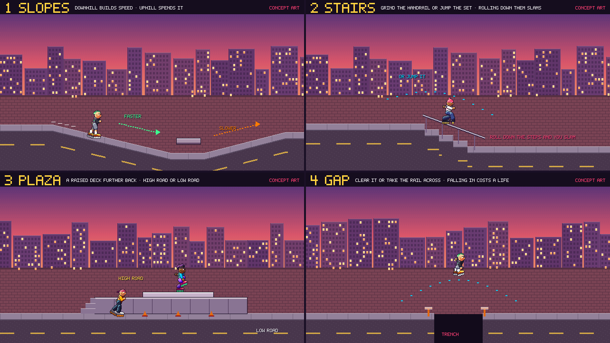
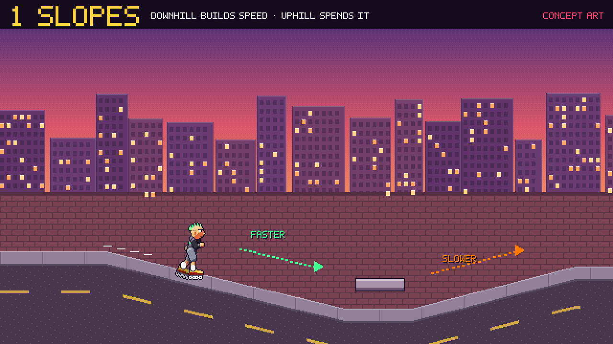
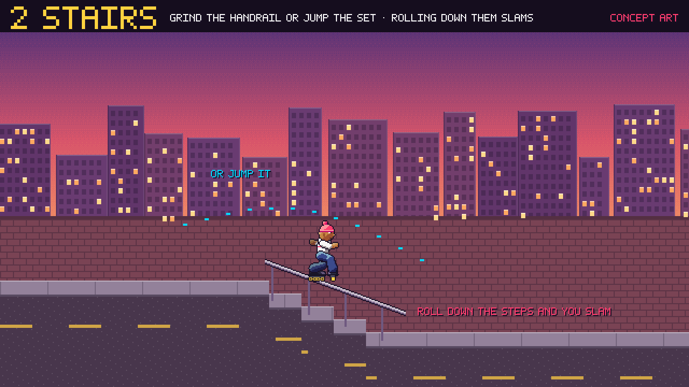
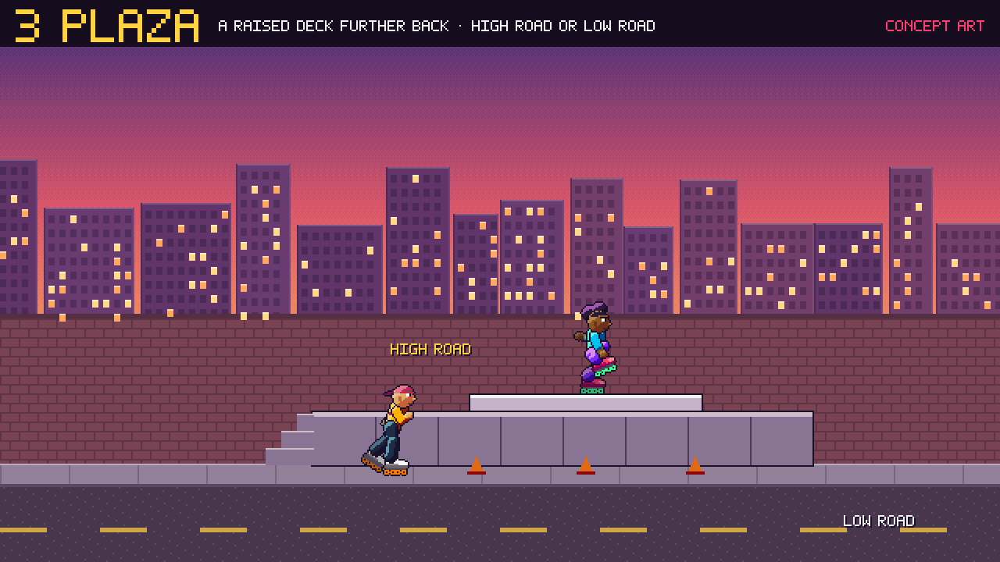
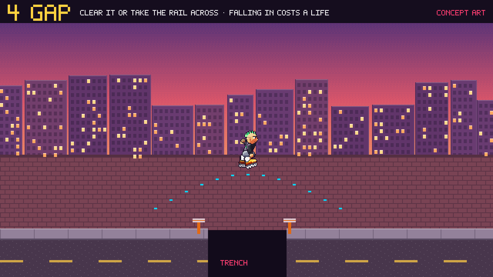

# Terrain — draft plan for vertical variation

**Status: a plan and concept art. Nothing here is built.** Drafted 2026-11-24 at the user's request
("tell me about our plans to add variation, and vertical variation into the levels: inclines, declines,
stairs, etc."). Companion to `CITIES.md`; this is the unbuilt half of backlog card T-16.

The pictures are mock screens painted by `npm run cities` into `docs/concept/`. They are not levels.

## 1. Where we are

| Exists today | What it does |
|---|---|
| Kicker ramps | The only place the ground rises: roll up, get launched |
| Sloped rails | Rails that run uphill or downhill while you grind |
| Stacked rails (STACKS course) | Rails above rails; jump up, ↓ to drop |

Everything else is flat. The street is one height from start to finish, and the camera never moves up or down.
The simulation already asks "how high is the ground here?" on every step (`Level.groundY`), but the only
answer other than zero is a kicker. Terrain means giving that question real answers.

## 2. The four pieces, easiest first

### Piece 1 — Slopes (inclines and declines)

- **What:** long gentle grades. Downhill you gain speed, uphill you lose it.
- **Adds:** speed as something you manage. Pushing before a climb matters; a downhill into a rail is fast and risky.
- **Decide:** how much faster (suggest a cap of about +30% so reaction time survives), and how quickly the
  extra speed bleeds off on the flat.
- **Cost:** small. Ground height becomes a line, speed gets a slope term, jumps launch along the slope.
  The bot needs nothing new.

### Piece 2 — Stairs and drops

- **What:** a stair set or a straight drop to a lower street, always with a handrail or a clean gap to jump.
- **Adds:** the classic skate spot. Grind the rail down, or jump the whole set for a big-air trick window.
- **Rule to settle:** rolling down the steps slams you (suggested — it is what makes the rail and the jump
  matter). The alternative is a harmless bumpy roll, which makes stairs scenery.
- **Cost:** medium. Landing at a different height than you left, a longer fall (so more air time than any
  jump today — long tricks finally fit), and the bot must learn to take the rail or jump.

### Piece 3 — Raised plazas (high road, low road)

- **What:** a wide deck a few steps up, standing back at the wall, with ledges and rails of its own on top.
  The street carries on in front of it.
- **Adds:** a real choice of route. The high road has the better spots; the low road has the hazards.
- **Follows the depth rule already agreed:** higher is further back. A plaza is the same idea as an upper rail,
  but wide enough to roll on.
- **Cost:** medium to large. Today "above the street" always means "on a rail". Rolling on a raised surface is
  a new state: you can push, turn and jump from it, and roll off its end.

### Piece 4 — Gaps

- **What:** a hole in the street — a trench, a canal, a missing stretch — sometimes with a rail across.
- **Adds:** the first hazard that is not an object. Clear it, grind across, or lose a life.
- **Caution:** recorded runs already average 39 seconds on three lives. Gaps shorten runs further unless
  lives change. Decide run length (see `PLAYTEST.md`, S7) before adding these.
- **Cost:** small once pieces 1–3 exist. Needs clear warning art well ahead of the edge.

## 3. Rules that need the user's call

| Question | Suggested | Why |
|---|---|---|
| Does downhill speed carry onto the flat? | Yes, fading over about a second | Otherwise slopes are just scenery |
| Rolling down stairs | Slam | Makes the rail and the jump the point |
| Missing a plaza's front edge | Slam, as ledges do today | Consistent; must be telegraphed early |
| Falling into a gap | Costs a life, restart just past it | A run-ending pit would be too harsh |
| Does the balance meter care about slope? | Downhill rails tip a little faster | Small, readable, rewards the Sydney idea |
| Bonus for the high road? | A small score multiplier while up there | Gives a reason to climb |

## 4. What it costs to build

- **Rules (`core/`):** ground height as a profile instead of a flat line; speed on slopes; falling off an edge;
  landing at any height; rolling on a raised deck. Each with tests, each behind a switch, one playtest ID each.
- **The bot:** must jump gaps, take rails down stairs and choose a route, or `npm run sim` cannot vouch for the
  new patterns. This is the part most likely to be underestimated.
- **The camera:** it never moves vertically today. With drops and climbs it has to follow, smoothly, and every
  background layer has to scroll with it. Needs a performance check on a phone.
- **Art:** slope surfaces, stair sets, deck fronts and edges, pit walls, and the back wall at changing heights.
  The concept screens show the wall simply extending down; real levels need it to look built that way.
- **Recordings:** safe. Terrain arrives as new patterns on new courses, so existing runs keep replaying.

## 5. How this ties to the cities

| City | Needs | Without terrain |
|---|---|---|
| New York | Piece 2 for subway stairs (optional) | Works today |
| Austin | None | Works today |
| Barcelona | Pieces 2 and 3: plazas, steps, stacked ledges | **Cannot be built properly** |
| Sydney | Pieces 1 and 2: slopes and long down-rails | A flat promenade only — half the idea |
| Mexico City | None | Works today |

So terrain decides which cities are possible, and argues for building New York and Austin first.

## 6. Suggested order

1. **Slopes**, alone, on a small test course. Smallest piece; tells us whether changing speed feels good.
2. **Stairs with a handrail.** The first real drop.
3. **Camera follow**, once there is something to follow.
4. **Plazas.**
5. **Gaps**, after the run-length decision.

Each step ships on its own, behind a switch, with a playtest — the way the rail changes were done.

## 7. Open questions for the user

1. Do the four pieces cover what you had in mind, or is something missing (half-pipes, banks, curved walls)?
2. Stairs: slam if you roll them, or harmless?
3. Should slopes change speed a lot (a mechanic) or a little (flavour)?
4. Is a moving camera acceptable, or should levels stay within one screen height?
5. Start with slopes as a test course now, or wait until the cities decisions are made?
